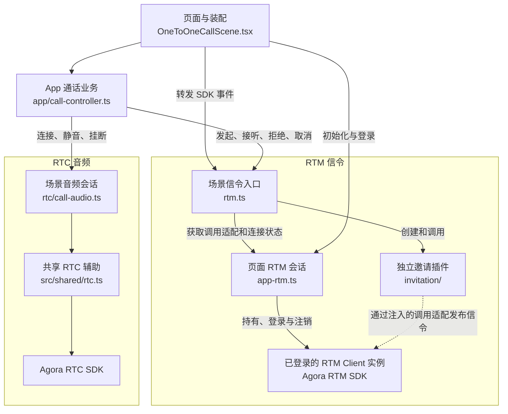

# 1V1 呼叫邀请模块与依赖关系

更新日期：2026-10-16

呼叫邀请 Demo 由页面装配、App 通话业务、场景信令入口、邀请插件、页面 RTM 会话和 RTC 音频六个核心模块组成。邀请插件管理信令生命周期，App 根据邀请结果建立音频；每个页面使用一个 RTM Client 实例。

## 1. 核心模块

| 模块 | 源码 | 职责 |
| --- | --- | --- |
| 页面与装配 | [OneToOneCallScene.tsx](../OneToOneCallScene.tsx) | 创建和连接各模块，渲染页面，绑定 SDK 事件与页面清理 |
| App 通话业务 | [app/call-controller.ts](../app/call-controller.ts) | 通过场景信令接口操作邀请，处理多来电选择、同时互拨、媒体等待、静音、挂断与资源清理 |
| 场景信令入口 | [rtm.ts](../rtm.ts) | 包装邀请插件，提供发起、接听、拒绝、取消等业务函数，以及只读邀请快照和状态事件 |
| 独立邀请插件 | [invitation/](../invitation/index.ts) | 管理邀请实例、协议、Caller/Callee 状态、ACK、重试与截止时间 |
| 页面 RTM 会话 | [app-rtm.ts](../app-rtm.ts) | 持有唯一 RTM Client，负责登录、SDK 事件监听、发布调用适配、连接状态与 RTM trace |
| RTC 音频 | [rtc/call-audio.ts](../rtc/call-audio.ts) | 管理单次音频会话、目标用户加入与离开、麦克风、错误信息和资源释放 |

## 2. Demo 依赖关系

实线表示主要调用依赖或实例管理，虚线表示通过注入的调用适配使用同一个已登录 RTM Client。图中的 RTM Client 是 SDK 实例，调用适配是 Demo 内部封装。



SDK 的 message/linkState 由页面 RTM 会话接收，经场景绑定交给 CallRtm，再由邀请插件消费。邀请状态通过 CallRtm 暴露给 App；App 观察到接受终态后建立音频。媒体失败、超时或挂断只结束 App 通话，已完成的邀请保留原终态。

AppCallController 同时协调邀请与音频，因此归入 app/；rtc/ 承载音频资源逻辑。邀请插件的实现依赖集中在 invitation/ 内部，可以整体复制接入已有应用。

### 2.1 SDK 事件处理职责

| 职责 | 实现位置 |
| --- | --- |
| Demo 的 SDK listener 与 trace | [app-rtm.ts](../app-rtm.ts) 注册 message/linkState，记录真实事件；场景绑定将事件转发到 CallRtm |
| 客户直接使用插件时的 SDK listener | [invitation/call-controller.ts](../invitation/call-controller.ts) 的 bindSdk() 为传入 Client 注册自己的监听，并在 dispose 时解绑 |
| 消息载荷校验 | [invitation/call-protocol.ts](../invitation/call-protocol.ts) 的 parseCallSignal() 校验 USER、customType、publisher、callId 与 payload |
| 邀请路由与重复消息处理 | [invitation/call-controller.ts](../invitation/call-controller.ts) 的 handleMessage() 按 callId 定位实例，核对对端，并处理重复 INVITE 和先到达的 CANCEL |
| 实例状态与截止处理 | [invitation/call-invitation.ts](../invitation/call-invitation.ts) 消费已校验信令和连接变化，检查当前状态、原截止与终态条件 |

插件处理的 SDK 事件集中在 message 和 linkState，入站职责由协议解析、邀请管理与单次邀请实例共同承担。App 通过状态事件和只读快照使用处理结果。

## 3. 已登录实例与调用适配

已登录的 RTM Client 实例由 Agora RTM SDK 创建，并由 AppCallRtmSession 完成登录和生命周期管理。邀请消息最终通过这个实例的 publish() 发送。

Demo 为记录每次真实 RTM API 的耗时、结果和错误，使用 getCallPort() 返回一个包含 publishToUser() 的调用适配对象。源码类型名为 CallRtmPort；它复用页面会话持有的 Client，并在发布时记录 trace。

CallRtm 创建邀请插件时注入该调用适配，并提供读取连接状态的函数。这个过程沿用已登录实例，无需为邀请插件再创建或登录另一个 Client。

因此，Demo 的信令发布路径是：

```text
AppCallController
  → CallRtm
    → Invitation / CallInvitation
      → publishToUser() 调用适配
        → 已登录的 RTM Client 实例.publish()
```

客户直接接入插件时，将已有的已登录 RTM Client 实例传入公共入口即可：

```ts
import { Invitation } from './invitation';

const invitations = new Invitation(rtmClient, { userId });
```

userId 与该 Client 使用的登录 UID 保持一致。插件自动绑定自己的 message/linkState 监听，并通过传入实例发布 USER 信令；Client 的创建、登录和注销由客户 App 管理。客户可保留自己的 SDK listener 处理其他业务消息。

Demo 页面注入共享 `getAgoraToken()` provider，仅在 RTM 登录和 RTC 入会前获取 Token，不增加续期或专门的失败提示。邀请插件不感知 Token Server，不保存凭证。鉴权模式只通过 `VITE_AUTH_MODE=token|none` 配置，见[根 README](../../../../README.md#鉴权模式)。

该接法使用 invitation/ 自身的 SDK 适配，接入时只需复制完整目录。Demo 的 CallRtm 和 AppCallRtmSession 用于场景业务接口与数据流展示。

## 4. 辅助模块与测试

| 模块 | 源码 | 用途 |
| --- | --- | --- |
| Demo 身份 | [app/identity.ts](../app/identity.ts) | 生成和保存当前 Tab 的呼叫 UID，校验输入和规范化昵称；客户可使用自己的账号与用户资料 |
| 体验进度 | [experienceProgress.ts](../experienceProgress.ts) | 根据真实 RTM trace 和已消费的业务状态更新体验任务 |
| RTM 数据流 | [shared/timeline/](../../../shared/timeline/traceStore.ts) | 保存和展示 RTM API/Event |
| 共享 RTC 辅助 | [shared/rtc.ts](../../../shared/rtc.ts) | 封装 RTC SDK 的频道加入、轨道发布、远端订阅与播放 |
| 组件测试辅助 | [test/scene.test-helpers.ts](../test/scene.test-helpers.ts) | 为场景与外壳测试提供可驱动的 RTM/RTC 替身 |
| E2E 音频替身 | [e2e/support/call-rtc.ts](../../../../e2e/support/call-rtc.ts) | 通过 BroadcastChannel 模拟双页面 RTC 加入与离开，复用真实 CallAudioSession |

普通开发与生产构建使用真实 RTC。E2E 模式由 [vite.config.ts](../../../../vite.config.ts) 替换场景的音频创建入口，页面沿用同一套装配逻辑。场景单元测试、组件测试和测试辅助集中在 test/，内部按 invitation/、app/、rtc/ 保留分组，测试文件命名为 *.test.ts(x)。完整验证步骤见[端到端回归流程](./1v1呼叫邀请端到端回归流程.md)。

信令接口与载荷见[功能与 RTM 函数映射](./1v1呼叫邀请功能与-rtm-函数映射.md)，邀请状态和握手过程见[状态流转与时序](./1v1呼叫邀请状态流转与时序.md)。
