# 1V1 呼叫邀请状态流转与时序

更新日期：2026-10-19

一次邀请在两端各有独立实例：Caller 发起，Callee 处理来电。实例只维护邀请结果，App 在接受后独立管理 RTC 音频。接口见[功能与 RTM 函数映射](./1v1呼叫邀请功能与-rtm-函数映射.md)，验证步骤见[端到端回归流程](./1v1呼叫邀请端到端回归流程.md)。

## 1. 接入分层、实例与信令

已有 SDK Client 的客户 App 通过 [invitation/index.ts](../invitation/index.ts) 导出的 `Invitation` 安装插件：

```ts
const invitations = new Invitation(rtmClient, {
  userId,
  onCallerStateChanged: event => renderCaller(event),
  onCalleeStateChanged: event => renderCallee(event),
  onIncomingInvitationsChanged: items => renderIncoming(items),
});
```

插件为同一个 Client 绑定自己的 message/linkState listener，发布固定使用 USER，不负责 login/logout。userId 由 App 提供并与 SDK 登录 UID 一致。默认 Client 已登录；login 前初始化须指定 `initialLinkState: 'disconnected'`。`dispose()` 只停止所属邀请和卸载自己的 listener，App 的其他 customType 仍由原有 SDK listener 处理。

直接接入 SDK Client 时，App 应先 dispose 插件再调用 SDK logout；SDK logout 会清理事件监听，重新登录后须重新安装插件。仅 STREAM 的连接变化不影响 USER 邀请。

Demo 的信令入口为 [rtm.ts](../rtm.ts)：AppCallController → CallRtm → invitation/index.ts。CallRtm 通过页面 Session 的 getCallPort()/getCurrentLinkState() 使用已登录端口与连接状态；页面 Session 持有唯一 SDK Client、登录和 trace，场景把 message/linkState 直接分发给 CallRtm。App 媒体层只调用 CallRtm，不持有插件或发布端口；昵称、互拨、单通媒体名额和 RTC 留在 App。

Demo 创建邀请得到 RtmInvitation，只提供 callId、getSnapshot 和 subscribe；发起/接听/拒绝/取消分别调用 CallRtm 的 sendCallInvitation/acceptCallInvitation/refuseCallInvitation/cancelCallInvitation。直接使用插件时得到可操作的 CallInvitation。两种接法使用相同状态机和信令，Caller/Callee 仍表示同一次邀请两端的实例。

邀请实现及错误辅助集中在 invitation/，整个目录可复制到已有 RTM SDK 的 App；不依赖 Demo 的场景适配器、React、RTC 或 SDK 生命周期封装。

每通 `CallInvitation` 固定 callId、角色与对端 UID，不可改绑或重用。Caller 的 `callerInvitations` 与 Callee 的 `incomingInvitations` 由插件管理；多个来电分别计时、操作和移除。

Caller 在 `createOutgoingInvitation()` 时创建实例并生成 callId；Callee 首次收到合法 INVITE 后才使用消息中的同一 callId 创建本端实例。两端对象独立，localUid 与 remoteUid 对应互换，重复 INVITE 复用既有 Callee 实例。

| 字段 | 含义 |
| --- | --- |
| `callId` | 16 字节随机值生成的 32 位大写十六进制字符串，同一邀请共用 |
| `extra` / `remoteExtra` | 本端发送与对端传来的 App 字符串，模块不解释内容 |
| `state` / `ended` | 角色状态与是否已进入稳定终态 |
| `startTs` / `endTs` | 当前本地阶段固定起点和绝对截止 |
| `publishing` | INVITE 或 accepted 发布是否在途，不构成新邀请状态 |
| `reason` / `trigger` | 业务失败原因和本次终结条件 |
| `sdkError` / `linkStateAtFailure` | SDK 原始错误和失败发生时的连接证据 |

四种 customType 为 `CALL_KIT_INVITE`、`CALL_KIT_ACCEPT`、`CALL_KIT_REFUSE` 和 `CALL_KIT_CANCEL`。payload 为 `{ callId, extra, type? }`，只有 ACCEPT 使用 `type: 'accepted' | 'ack'`。`extra` 可省略输入、缺省空串，通过 remoteExtra 暴露。独立 App 业务消息使用自己的 customType 与 SDK listener，不混用邀请信令。

邀请管理器只路由 USER 类型的四种邀请信令。已有实例按 callId 定位，并核对 SDK publisher 是否为该实例固定的对端 UID；不匹配的消息不交给实例消费，其他业务消息仍由 App 自己的 listener 处理。

下列时序的 Caller/Callee 均表示邀请实例；跨端箭头表示 RTM USER publish，SDK Promise 结果用发送端自消息表示。各端 App 的媒体处理写在本端注释中，不是额外邀请状态或传输回执。

## 2. 两套角色枚举

| CallerInvitationState | 含义 |
| --- | --- |
| `IDLE(0)` | 新建，尚未 start |
| `SENT_TO_CALLEE(1)` | 发送 INVITE，等待发布结果或重试 |
| `RECEIVED_BY_CALLEE(2)` | INVITE publish resolve 后等待有效响应 |
| `ACCEPTED_BY_CALLEE(3)` | 已有效消费 accepted，接受终态 |
| `REFUSED_BY_CALLEE(4)` | 已有效消费 REFUSE，拒绝终态 |
| `CANCELED(5)` | Caller 主动取消终态 |
| `FAILURE(6)` | 发送、等待、本地连接或停止导致的失败终态 |

| CalleeInvitationState | 含义 |
| --- | --- |
| `IDLE(10)` | 新建，尚未消费 INVITE |
| `INVITATION_RECEIVED(11)` | 已接收来电，accepted 发布中也保持此状态 |
| `ACCEPT_SENT_TO_CALLER(12)` | accepted publish resolve，等待有效 ACK |
| `ACCEPTED(13)` | 已有效消费 ACK，接受终态 |
| `REFUSED(14)` | Callee 主动拒绝终态 |
| `CANCELED_BY_CALLER(15)` | Callee 收到有效 CANCEL 的终态 |
| `FAILURE(16)` | 处理过期、ACK 超时、本地连接或停止导致的失败终态 |

接受、拒绝、取消和失败均保留原终态，不返回 `IDLE(0)` 或 `IDLE(10)`。App 可回到空闲并创建新实例，`ended=true` 不表示媒体已结束。

## 3. Caller 状态图

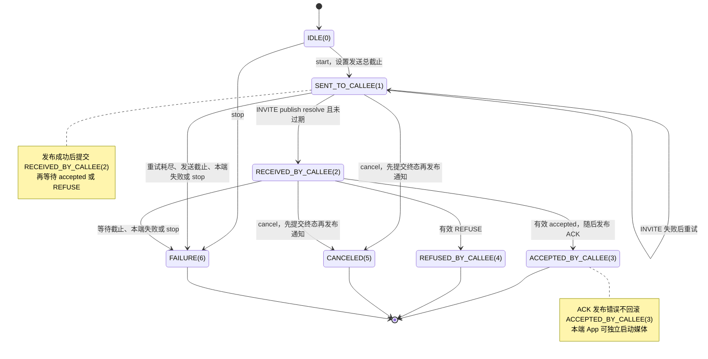

`RECEIVED_BY_CALLEE(2)` 采用 USER INVITE publish 成功的语义，不证明 Callee 页面已显示来电。重试期间保持 `SENT_TO_CALLEE(1)`，不重复发出状态变化通知。

## 4. Callee 状态图

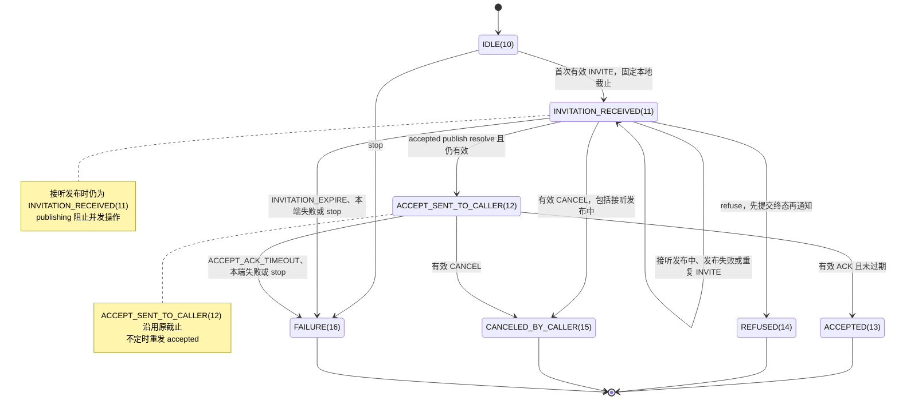

accepted 发布中不可并发 accept/refuse；发布失败且仍有效时可再次操作。进入 `ACCEPT_SENT_TO_CALLER(12)` 后不可再次接听或本地拒绝，仍可消费 CANCEL。

## 5. 时间窗口与配置

| 窗口 | 起点 | 默认配置 | 到期结果 |
| --- | --- | --- | --- |
| INVITE 总发送 | 首次 start | `sendTimeoutMs=30000` | `SENT_TO_CALLEE(1) → FAILURE(6)`，trigger=SEND_TIMEOUT |
| Caller 等待响应 | 首次 INVITE publish resolve | `callerInvitationExpireMs=30000` | `RECEIVED_BY_CALLEE(2) → FAILURE(6)`，本端正常时 reason=PEER_NO_RESPONSE |
| Callee 处理与 ACK | 首次消费 INVITE | `calleeInvitationExpireMs=30000` | `INVITATION_RECEIVED(11) → FAILURE(16)` 为 INVITATION_EXPIRE；`ACCEPT_SENT_TO_CALLER(12) → FAILURE(16)` 为 ACCEPT_ACK_TIMEOUT |

默认 `maxRetries=2`、`retryIntervalMs=2000`，首次加两次重试，最多发布三次。某次成功即停止重发；次数耗尽立即失败，发送总截止独立生效。重试不延长发送截止，Callee 的重复 INVITE、再次接听和等待 ACK 不延长原截止。

每阶段固定 startTs/endTs，倒计时按 `Math.max(0, endTs - Date.now())` 计算，timer 仅唤醒检查。`now >= endTs` 即过期。操作、消息、发布结果和重试前均先查截止；两端起点独立，不保证同时到期。

ACCEPT 与 ACK 不定时重发。Caller 已为 `ACCEPTED_BY_CALLEE(3)` 时，可在有限确认窗口内对重复 accepted 幂等补发 ACK，不重复状态通知，不恢复其他终态。

## 6. 正常接听

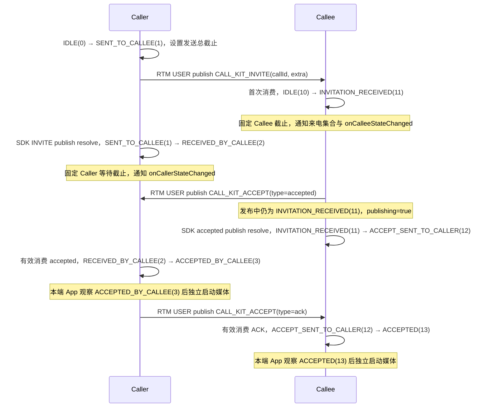

Caller 提交 `ACCEPTED_BY_CALLEE(3)` 不等待 ACK publish resolve。Callee 必须消费有效 ACK 才提交 `ACCEPTED(13)`。ACK 确认接受，不确认 RTC 已连接。

## 7. 主叫发送与响应顺序

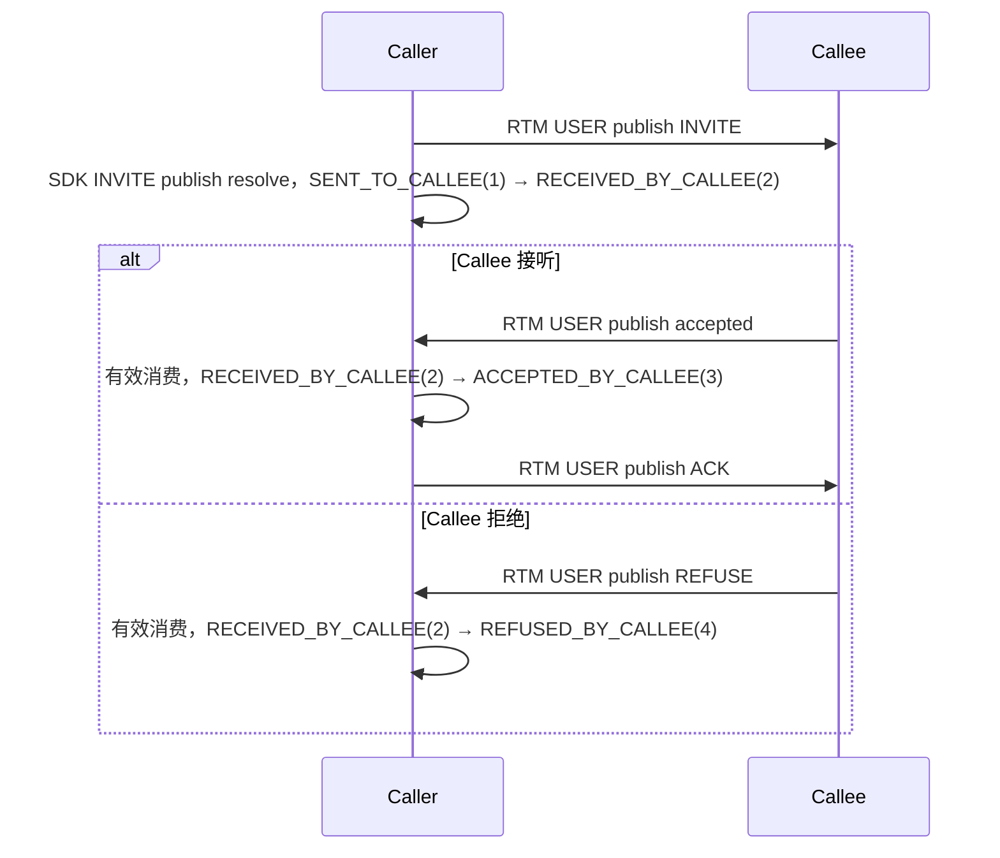

Caller 只在 `RECEIVED_BY_CALLEE(2)` 消费 accepted 或 REFUSE；消息必须匹配本次 callId 与预期 Callee 的 publisher。其他状态下的响应直接忽略。发送失败、取消或到期后，迟到消息和 SDK 结果不能重新激活邀请。

## 8. 被叫接听与确认顺序

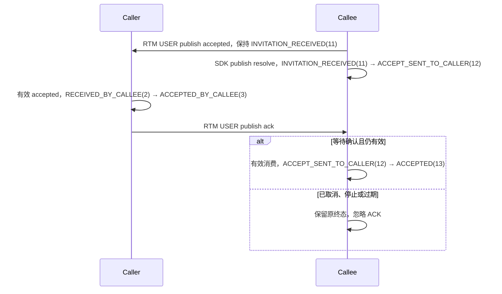

ACK 只在 `ACCEPT_SENT_TO_CALLER(12)` 消费，并须匹配本次 callId 与预期 Caller 的 publisher。其他状态下的 ACK 直接忽略，未点击接听的来电不能凭 ACK 进入接受终态。

## 9. INVITE 重试、耗尽与发送截止

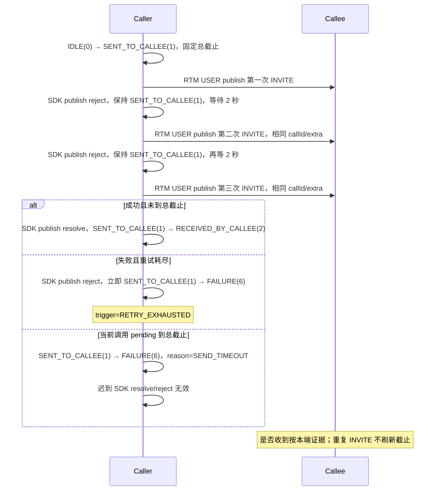

跨端箭头表示发布尝试，不保证失败调用的消息已被 Callee 消费。总发送截止可在任何调用或间隔中先到；`maxRetries=0` 只尝试一次。恢复后不集中补发错过的重试。

## 10. 拒绝、取消与通知错误

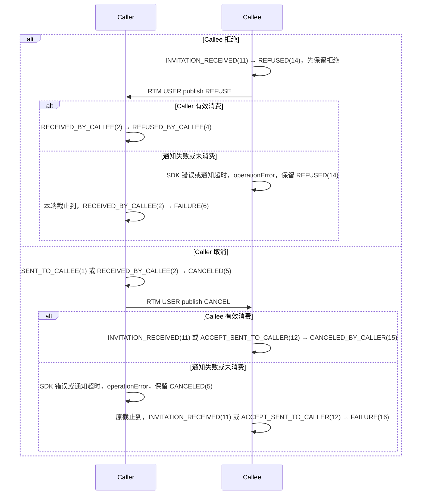

通知错误不回滚已提交的 `REFUSED(14)` 或 `CANCELED(5)`，REFUSE/CANCEL 不需要业务 ACK。

## 11. 接听发布中取消与迟到响应

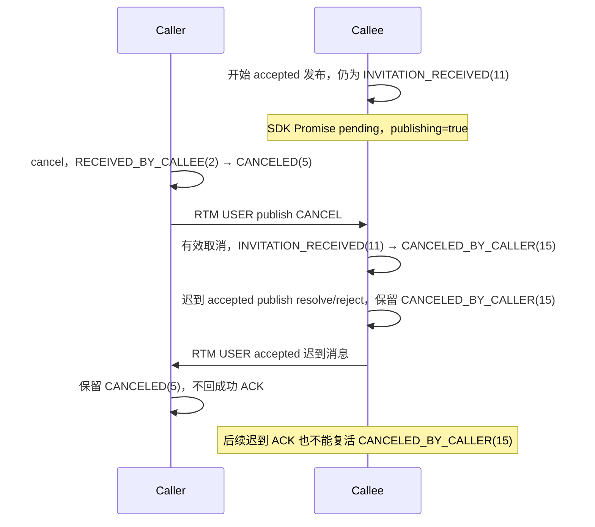

终态先提交，发布结果不能覆盖它。CANCEL 早于 INVITE 到达时，按 callId/publisher 记录取消，抑制随后同一邀请。

## 12. 接听发布失败或 pending 到期

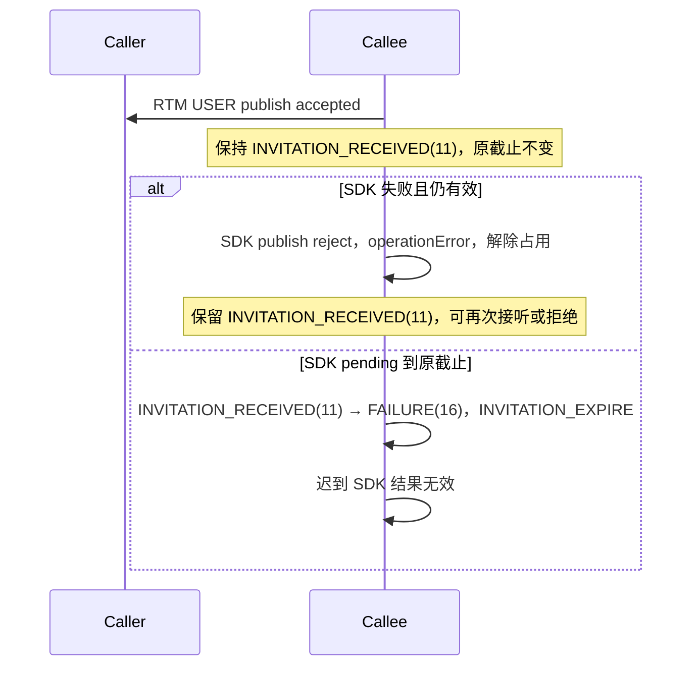

单次接听发布失败不立即终结来电、不定时重发，也不重复通知 `INVITATION_RECEIVED(11)`。无后续操作或取消时，仍按原截止进入 `FAILURE(16)`。

## 13. ACK 丢失与双方终态差异

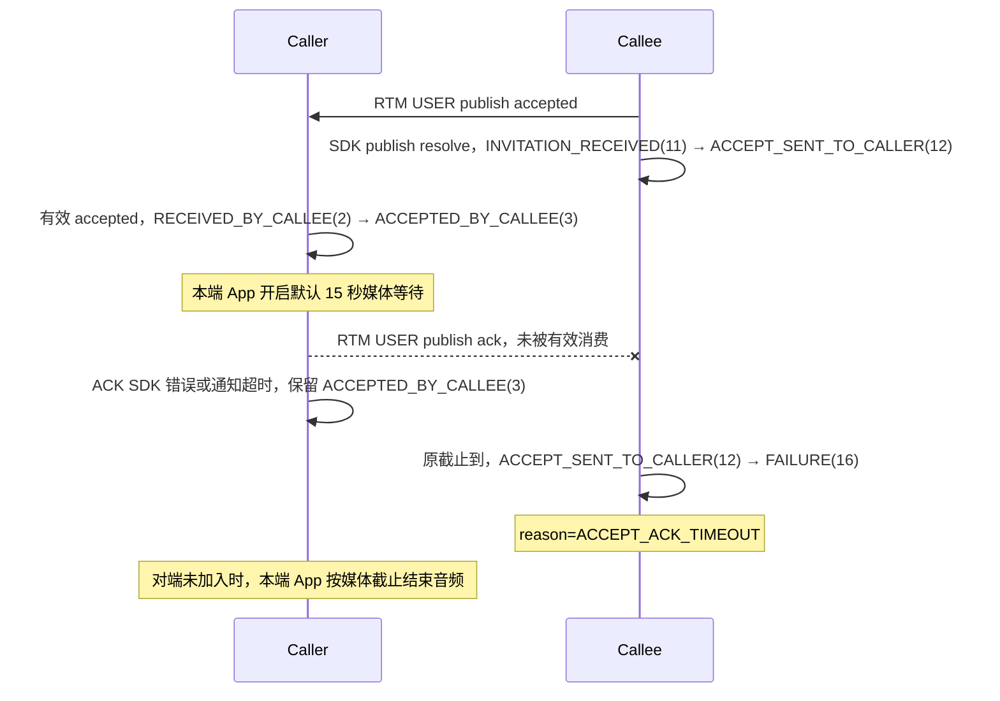

ACK 不保证两端全局原子终态，可能 Caller 为 `ACCEPTED_BY_CALLEE(3)`、Callee 为 `FAILURE(16)`。后续迟到 ACK 不改变结果，App 媒体不能反向改写邀请。

## 14. 无人应答与截止边界

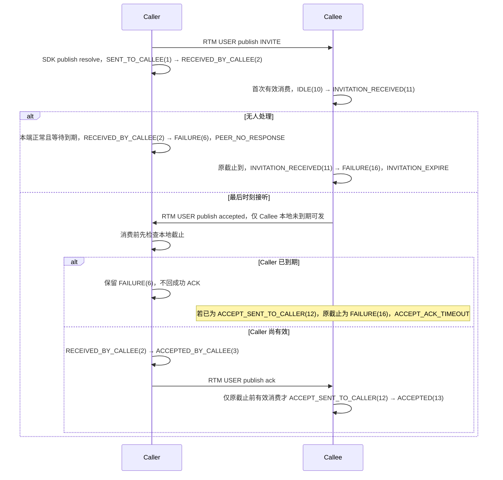

`INVITATION_RECEIVED(11)` 到期时即使发布在途仍为 INVITATION_EXPIRE；只有 `ACCEPT_SENT_TO_CALLER(12)` 到期使用 ACCEPT_ACK_TIMEOUT。两端窗口独立，不要求同一毫秒到期。

## 15. 多来电与媒体名额

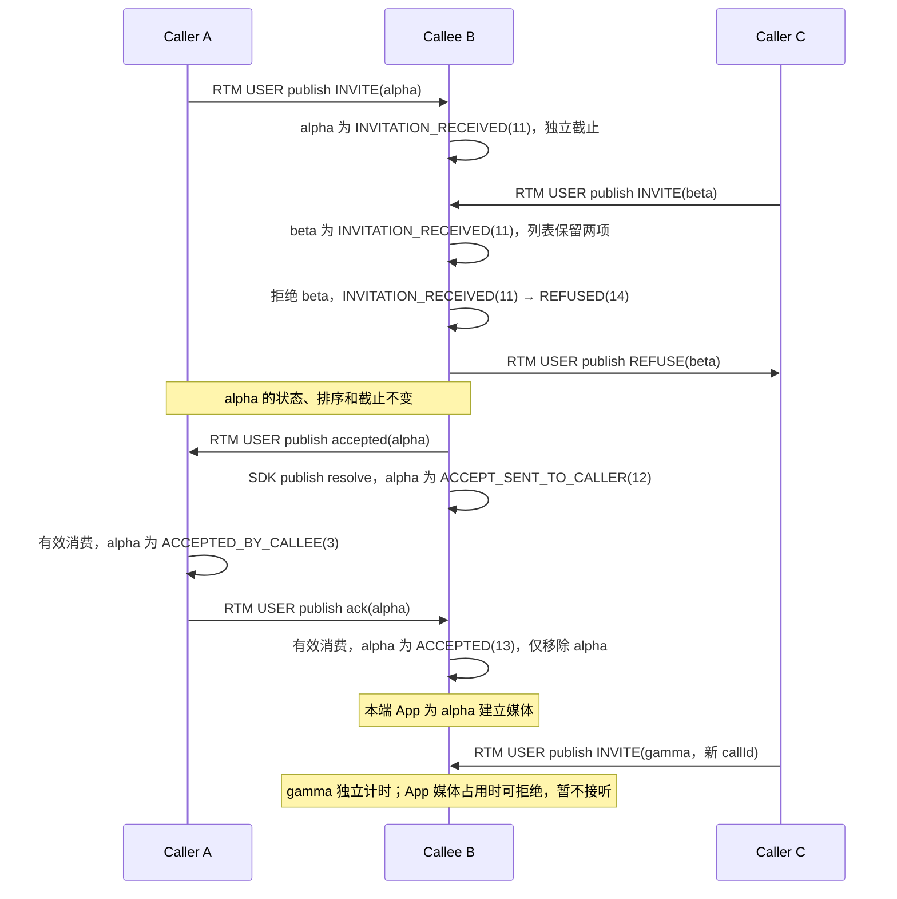

纯插件不自动拒绝其他来电。Demo App 一次预留一通音频，其他项继续计时，媒体释放后可接听仍有效的来电。

## 16. 睡眠与恢复

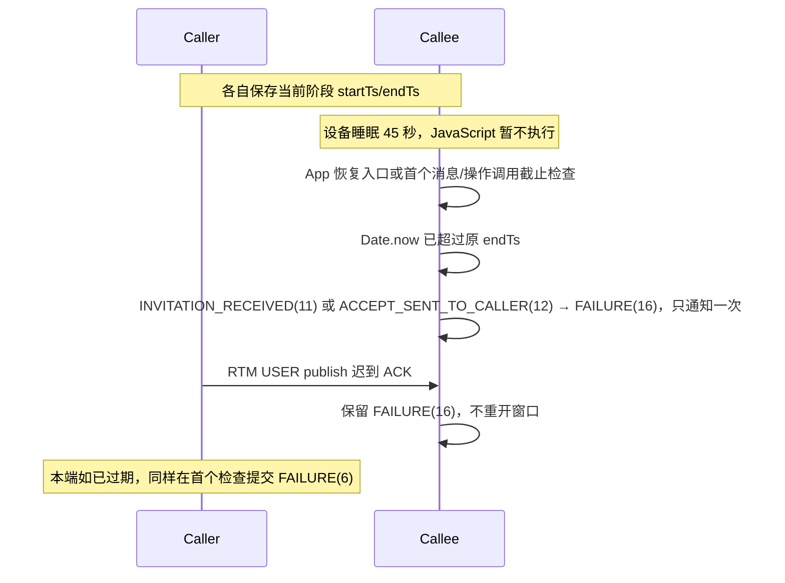

visibilitychange 恢复可见、pageshow、focus 和 RTM 重连成功是补充入口；模块自身 timer、操作、消息、重试和异步结果也会重检。恢复时尚有效则按原截止和预算继续，冻结期间不承诺在到期瞬间执行回调。

## 17. App 媒体与挂断

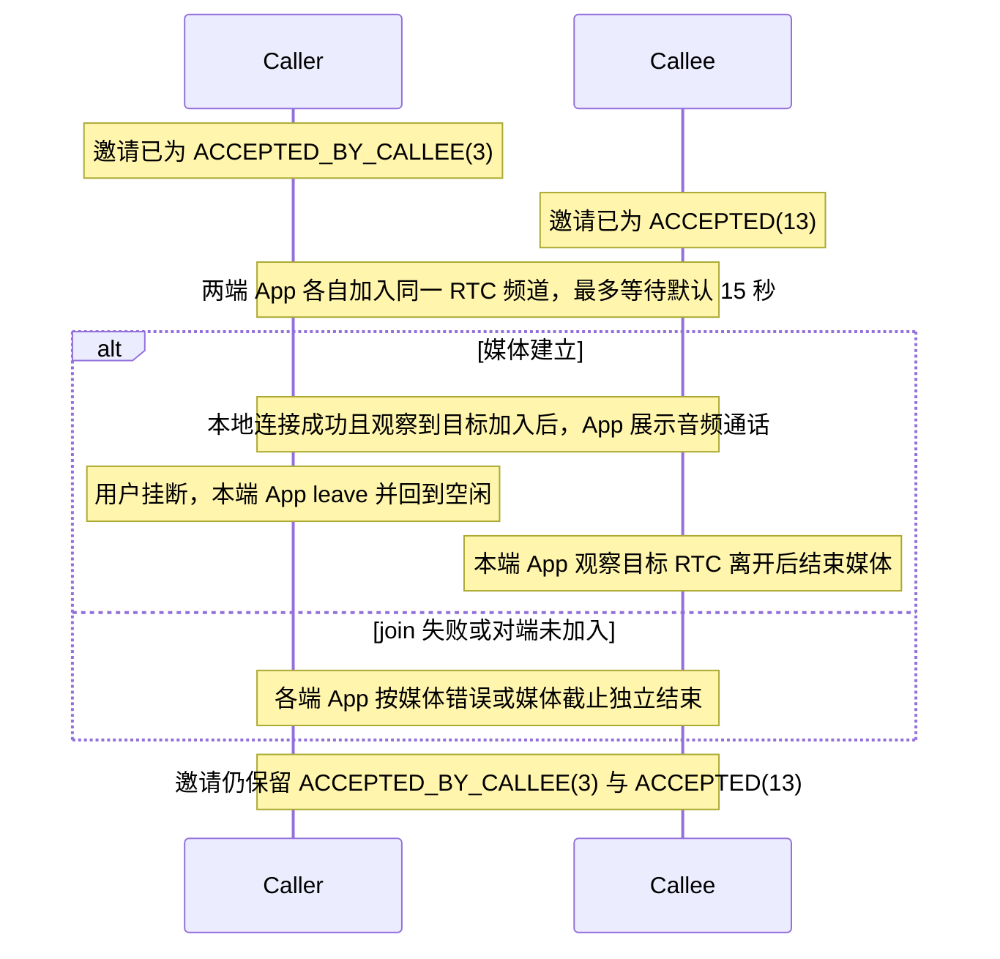

邀请不包含媒体状态；App 静音、采集失败、重试和挂断不改变接受终态。对端尚未入会时，本地挂断不保证对端立即结束，其 App 仍有媒体截止兜底。每通媒体资源独立，旧清理不得影响下一通通话。

## 18. 通知与错误证据

`onCallerStateChanged`、`onCalleeStateChanged`、`callerStateChanged`、`calleeStateChanged` 与实例 `stateChanged` 来自同一次提交。事件含完整快照、previousState、sequence 和 timestamp；提交后通知，重入事件保持顺序，监听异常不阻断其他监听。

直接使用插件时，Caller 在 start 前注册实例监听；Callee 在 incomingInvitation 中注册可观察首个 `INVITATION_RECEIVED(11)`，也可直接 accept/refuse。Demo 通过 CallRtm.on 接收状态，incomingInvitation 返回只读 RtmInvitation，操作经业务函数执行。incomingInvitationsChanged 返回完整待处理集合，`ACCEPT_SENT_TO_CALLER(12)` 仍保留，终态仅移除对应项。晚注册读取快照，退订不取消邀请。

| 证据 | reason | 结果/trigger |
| --- | --- | --- |
| SDK `-11033` 明确目标离线 | PEER_OFFLINE | Caller `FAILURE(6)`，按实际条件记录 RETRY_EXHAUSTED/SEND_TIMEOUT |
| 发布错误时本端非 connected | LOCAL_NETWORK_ERROR | 对应 `FAILURE(6)` 或操作错误，保留当时连接证据 |
| 本端 connected，SDK `-11026` 发布超时 | PUBLISH_TIMEOUT | Caller `FAILURE(6)` 或独立操作错误 |
| 本端 connected，其他发布错误 | PUBLISH_FAILED | Caller `FAILURE(6)` 或独立操作错误 |
| 当前 INVITE pending 到发送总截止 | SEND_TIMEOUT | `FAILURE(6)`，trigger=SEND_TIMEOUT，不编造 sdkError |
| Caller `RECEIVED_BY_CALLEE(2)` 等待到期且本端正常 | PEER_NO_RESPONSE | `FAILURE(6)`，trigger=INVITATION_TIMEOUT |
| Callee `INVITATION_RECEIVED(11)` 到期 | INVITATION_EXPIRE | `FAILURE(16)`，trigger=INVITATION_TIMEOUT |
| Callee `ACCEPT_SENT_TO_CALLER(12)` 到期 | ACCEPT_ACK_TIMEOUT | `FAILURE(16)`，trigger=ACK_TIMEOUT |
| 连接彻底 failed | LOCAL_NETWORK_ERROR | 未终结邀请进入 `FAILURE(6)` 或 `FAILURE(16)`，trigger=LINK_FAILED |
| 显式 stop/dispose | STOPPED | 未终结邀请进入 `FAILURE(6)` 或 `FAILURE(16)`，trigger=STOPPED |

暂时断连不重置截止；Caller `RECEIVED_BY_CALLEE(2)` 到期仍未连接时使用 LOCAL_NETWORK_ERROR。reason、trigger、sdkError、linkStateAtFailure 分别记录原因、触发条件、SDK 原错和失败时状态，后续 CONNECTED 不覆写原证据。

accepted 发布失败时保留仍有效的 `INVITATION_RECEIVED(11)`；REFUSE、CANCEL、ACK 发布错误不回滚 `REFUSED(14)`、`CANCELED(5)`、`ACCEPTED_BY_CALLEE(3)`。相同 callId 来自其他 publisher、非法协议、状态不匹配或迟到消息均忽略，不影响其他实例。
