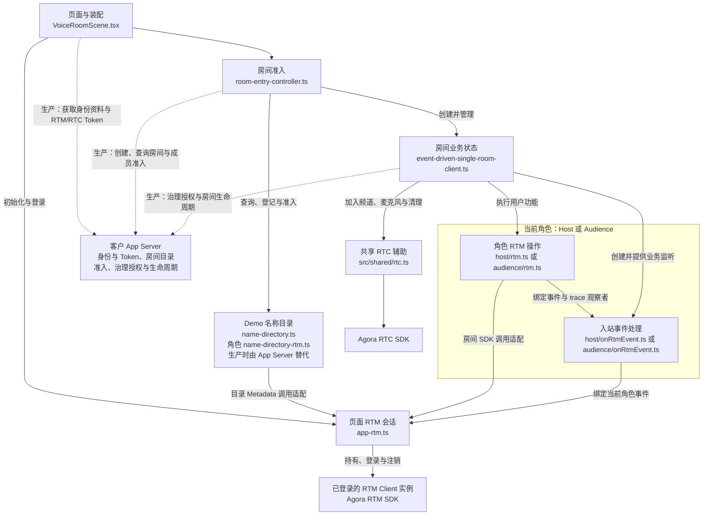

# 语聊房模块与依赖关系

更新日期：2026-10-23

语聊房由页面装配、房间准入、业务状态、角色 RTM 操作、入站事件处理、页面 RTM 会话与共享 RTC 辅助组成。每个页面只有当前 Host 或 Audience 角色，复用一个 RTM Client 实例；声音通过 RTC 传输。

生产接入还需要客户 App Server 提供业务鉴权、身份资料、房间目录、成员准入、治理授权与 RTM/RTC Token。当前仓库提供客户端 Demo，服务端职责在下图和第 4 节标注。

## 1. 核心模块

| 模块 | 源码 | 职责 |
| --- | --- | --- |
| 页面与装配 | [VoiceRoomScene.tsx](../VoiceRoomScene.tsx) | 创建页面会话与准入控制器，渲染入口和房间，绑定体验进度、数据流和页面清理 |
| 房间准入 | [room-entry-controller.ts](../room-entry-controller.ts) | 协调创建、加入、刷新恢复与离房，再创建当前房间业务对象；生产时房间查询和准入以 App Server 的授权结果为依据，Demo 通过名称目录模拟检查 |
| 房间业务状态 | [event-driven-single-room-client.ts](../event-driven-single-room-client.ts) | SingleRoomClient 保存和消费房间、成员、麦位、排麦与消息状态，调用当前角色 RTM 函数，并协调 RTC |
| Host RTM 操作 | [host/rtm.ts](../host/rtm.ts) | 将房间初始化、麦位、公告、邀请、治理和房内消息映射到 RTM API，记录调用与事件 trace |
| Audience RTM 操作 | [audience/rtm.ts](../audience/rtm.ts) | 将申请上麦、响应邀请、下麦、临时状态和房内消息映射到 RTM API，记录调用与事件 trace |
| 角色入站事件 | [host/onRtmEvent.ts](../host/onRtmEvent.ts)、[audience/onRtmEvent.ts](../audience/onRtmEvent.ts) | 绑定当前角色事件，过滤来源、房间与目标，校验消息有效期、去重，并把合法事件交给业务状态消费 |
| 页面 RTM 会话 | [app-rtm.ts](../app-rtm.ts) | 持有唯一 RTM Client，在登录前注册 SDK listener，负责登录、事件分发和 SDK 调用适配，记录登录与连接状态 trace |
| 共享 RTC 辅助 | [shared/rtc.ts](../../../shared/rtc.ts) | 封装 RTC SDK 的频道加入、音频采集与发布、远端订阅与播放，以及资源释放 |

## 2. 主要依赖关系

实线表示现有 Demo 的主要调用依赖或实例管理，虚线表示生产接入需要补充的 App Server 调用。图中的服务端接口由客户实现，当前 Demo 通过浏览器逻辑和名称目录演示部分交互。当前角色模块按 Host 或 Audience 二选一，复用同一个已登录 RTM Client 实例。



SDK 事件的返回路径是：

```text
RTM Client 的 message / presence / storage / linkState 事件
  → AppRtmSession
    → 当前角色的 onRtmEvent.ts
      → SingleRoomClient 消费合法事件并更新业务状态
        → 页面刷新展示，或执行后续 RTM / RTC 操作
```

入站事件处理通过角色 RTM 模块提供的观察者记录事件 trace，再执行业务消费。页面会话独立记录登录和 linkState，避免角色重复记录连接事件。

## 3. Client 实例与调用适配

AppRtmSession 持有 SDK 创建的真实 RTM Client 实例。HostRoomRtm、AudienceRoomRtm 和 SingleRoomClient 都是场景对象，分别承担角色功能与业务状态；它们复用页面会话持有的 SDK 实例。

角色 RTM 模块通过 getRoomPort() 取得房间 SDK 调用适配。源码类型名为 AppRoomRtmPort，包含订阅、发布、Presence 和 Storage 等操作，内部委托给同一个 Client。目录适配器通过 getDirectoryPort() 调用该 Client 的 Metadata API。每次业务对象创建或角色切换都沿用页面会话。

业务调用使用 requestSeat()、approveSeatRequest()、muteMicrophone() 等功能函数，RTM 模块负责固定具体消息类型、Metadata key 和 SDK 参数。入站校验与状态消费由 onRtmEvent.ts 和 SingleRoomClient 分别承担。

房间 Storage 保存权威房间状态，Presence 保存在线成员临时状态，消息表达瞬时动作。SingleRoomClient 消费这些事件形成页面视图，并根据麦位和本端操作协调 RTC；麦克风发布结果不会回滚 Storage 中的麦位归属。

## 4. App Server 职责与 Demo 替代实现

### 4.1 生产接入需要实现的服务端职责

| 职责 | App Server 需要提供 | 当前 Demo 的处理 | 对接位置 |
| --- | --- | --- | --- |
| 业务账号与身份资料 | 认证业务账号，维护 App UID、RTM UID、昵称和头像的关系，返回当前用户资料 | 浏览器生成页面 UID，通过 Presence 同步昵称供演示展示 | 页面初始化与成员资料查询；身份字段进入页面会话和业务状态 |
| RTM/RTC Token | 按已认证用户与业务权限签发 Token，并提供续期接口；App Certificate 保存在服务端 | 不生成 Token，不接收 App Certificate；当前未提供完整的 Token 获取与续期流程 | 登录 RTM、加入 RTC 前获取凭证，并对接后续凭证续期 |
| 房间创建与目录查询 | 生成和持久化 roomId、Host、房间状态与名称映射，处理并发创建和同名竞争 | 名称目录使用 RTM Metadata 和 revision 竞争写入模拟 | RoomEntryController 的创建、查询和刷新恢复流程 |
| 成员准入 | 根据业务身份、角色、房间状态、成员关系和封禁记录判断是否允许进入，返回授权结果 | 入房前由客户端读取目录并检查 status、roomId 与 banUserIds | 实际房间 subscribe 与 RTC join 前的准入流程 |
| 治理授权与封禁记录 | 校验踢出、封禁、强制麦控和解散等操作权限，持久化必要记录，并结合实际访问权限执行限制 | Host 客户端写状态并发送协作通知，封禁名单暂存在目录 | App 业务操作及后续准入；客户端按已授权结果同步 RTM 状态和通知 |
| 房间生命周期 | 管理解散、目录失效、封禁等持久业务结果，处理并发操作和迟到请求 | Host 客户端按流程更新目录、通知成员并清理实际房间状态 | 房间管理操作、RoomEntryController 的目录回调与业务退出流程 |

服务端接口对接在客户端业务流程中，实际房间的 Storage、Presence 和 Message 仍由角色 RTM 模块协作同步。客户端的 generation 检查用于保护本地在途操作；跨客户端的业务一致性、鉴权与持久化由 App Server 负责。

客户端消费踢出、封禁和强制麦控通知属于协作行为。生产应用需要在服务端完成授权判断并执行实际访问限制。用户资料由业务服务端或业务资料缓存提供，Presence 继续承载 muted、microphoneError 等在线临时状态。

### 4.2 Demo 入口辅助文件

| 模块 | 源码 | 用途 |
| --- | --- | --- |
| 名称目录 | [name-directory.ts](../name-directory.ts) | 解析和读取名称对应的 roomId、Host、房间状态与封禁名单 |
| Host 目录适配 | [host/name-directory-rtm.ts](../host/name-directory-rtm.ts) | 通过页面会话读取、登记和清理目录记录 |
| Audience 目录适配 | [audience/name-directory-rtm.ts](../audience/name-directory-rtm.ts) | 通过页面会话读取目录，供入房前检查 |
| 房间名称与链接 | [room-name.ts](../room-name.ts)、[voice-room-url.ts](../voice-room-url.ts) | 规范化房间名称，编码和解析页面身份与房间信息，支持刷新恢复和已有链接 |
| 昵称 | [nickname.ts](../nickname.ts) | 规范化输入、提供默认昵称与展示规则 |

RoomEntryController 先通过目录完成名称查询、登记或准入，再创建 SingleRoomClient 并订阅实际房间。目录与实际房间使用不同的 Metadata 频道，沿用同一个 RTM Client；目录没有 subscribe，也不进入房间数据流。

名称目录是无 App Server Demo 的替代实现。客户应用应由自己的 App Server 负责房间创建与查询、成员准入、封禁、身份资料和生命周期。Demo 中的踢出、封禁和强制麦控属于客户端协作，不构成服务端权限控制。目录细节见[按名称加入与共享目录](./按名称加入与共享目录.md)。

## 5. 体验与测试辅助

| 模块 | 源码 | 用途 |
| --- | --- | --- |
| 体验进度 | [experienceProgress.ts](../experienceProgress.ts) | 根据真实 RTM trace 和已消费的业务状态更新体验任务 |
| 数据流 | [shared/timeline/](../../../shared/timeline/traceStore.ts) | 归并和展示页面会话、角色 RTM 的 API/Event trace |
| 组件测试替身 | [test/testing.ts](../test/testing.ts) | 为页面与外壳测试提供可驱动的 RTM/RTC 替身 |
| 目录测试替身 | [test/name-directory.testing.ts](../test/name-directory.testing.ts) | 为名称目录与准入测试提供内存实现 |
| E2E | [e2e/lab.spec.ts](../../../../e2e/lab.spec.ts)、[e2e/support/agora-rtm.ts](../../../../e2e/support/agora-rtm.ts) | 验证双页面交互，使用 RTM 替身协作同步 |

语聊房的 E2E RTC 替身由 VoiceRoomScene.tsx 中的 createE2eRtc() 提供，在 e2e mode 注入。它以空实现完成媒体接口调用；普通开发使用共享 RTC 辅助连接真实 SDK。完整验证步骤见[端到端回归流程](./语聊房端到端回归流程.md)。

场景单元测试、组件测试和测试辅助集中在 test/，角色测试保留 test/host/ 与 test/audience/ 层级。场景业务文件通过相对导入参与测试，E2E 位于根目录 e2e/。

## 6. 源码阅读入口

理解 RTM 使用时，优先阅读 app-rtm.ts、Host/Audience 的 rtm.ts 和 onRtmEvent.ts，共五个文件。需要了解房间状态如何消费、界面如何更新以及 RTC 如何衔接时，再阅读 event-driven-single-room-client.ts；需要了解按名称创建和加入流程时，再阅读 room-entry-controller.ts 与目录适配器。

具体功能到源码的映射见[功能与 RTM 函数映射](./语聊房功能与-rtm-函数映射.md)，发送与接收过程见[功能、底层 RTM API、事件与时序](./语聊房功能底层-RTM-API-事件与时序.md)。

## 7. 关键实现约束

本节承接项目 Agent 入口中的语聊房细节；功能契约、API 参数与完整时序仍以上述正式文档为准，视觉尺寸以[设计规范](../../../../design/rtm-experience-hall/README.md)为准。

### 7.1 页面会话、准入与房间生命周期

- `AppRtmSession` 在场景挂载时创建 Client，登录前绑定监听；同页登录失败重试和角色切换复用它。角色离房只退订；真正卸载或 `pagehide` 时幂等清理并尽力注销，Strict Mode 模拟卸载不注销。跨场景导航整页加载。
- 鉴权模式下，页面注入共享 `getAgoraToken()` provider，仅在 RTM 登录和 RTC 入会前获取 Token，不新增续期或专门的失败提示；角色 RTM、目录和业务 store 不复制 Token 状态，HTTP 申请不进入 RTM 数据流。
- `RoomEntryController` 用 generation 守卫每次准入和订阅的异步结果，避免已失效操作重新进入房间。实际房间 subscribe 前先完成目录检查与 `initializeMemberState(displayName)`；Host 同时写 `muted=false`，未上麦 Audience 不写 `muted`。
- `subscribeRoom()` 只等待 SDK 订阅，不等待 Storage 或 Presence 首快照；成功立即撤掉初始蒙层、推进连接任务并启动 RTC，依赖权威 Metadata 的操作仍需等状态到达。
- 名称目录只在入房前访问，不订阅、不进入数据流。Host 新建用读取的 `majorRevision` 竞争写入，失败间隔 300ms 重新读取，最多三次；未知写入结果只能在 hostUserId 与本轮 roomId 都匹配时确认成功。登记后订阅失败的回滚也必须核对两者并携带 revision。
- active 目录不按本地缓存时间或 Host 离线自动过期。Host 暂时离开只退出 RTC 和退订，保留本轮 payload 供“以 Host 身份返回”；Audience 只标记 `hostTemporarilyAway`，不把 Presence 中缺席的 Host 当作解散。
- 解散依次执行目录 inactive、`room.dissolved`、清理四项实际房间 Metadata、退订、带身份与 revision 条件删除目录。清理前阻止新写入并等待在途写入；实际房间清理失败间隔 300ms，最多三次。未完成清理保留重试入口，只补做未完成步骤，不允许迟到清理删除同名新房间。
- Audience 收到 `room.dissolved` 或实际房间空 Metadata 时退出；断线后不能仅凭 `CONNECTED` 恢复交互，须等实际房间 Storage 全量事件，完整有效的四项状态恢复交互，空状态按解散处理。不补读目录、不重复订阅、不重放历史消息，不调用 `whoNow` 或 `presence.getOnlineUsers()` 补齐在线成员。

### 7.2 Storage、Presence 与昵称

- 实际房间 Metadata 只有 `hostUserId`、`announcement`、`seats`、`forcedMutedUserIds`。Host 仅在空 Storage `SNAPSHOT` 上按该快照 `majorRevision` 初始化一次；非空全量事件替换业务 store。Audience 不写实际房间 Storage，各端不主动 `getChannelMetadata()`，不使用 Lock。
- nickname 来自 Presence：本端初始化写入成功且尚未离房时更新本地映射，远端按事件更新。业务消息不携带 nickname；按 publisher UID 调用 `getNickNameByUid()`，不从 `seat.displayName` 推断昵称。Host 缺昵称或离线时降级为 `Host`，其他成员降级为省略后的 UID。
- Presence `SNAPSHOT` 全量替换在线与昵称状态，不保留快照中缺失的旧 nickname。本端缺 `muted` 按 `false`；远端缺 `muted` / `microphoneError` 时删除对应缓存并按 `false` 展示。其他成员事件增量处理。
- `REMOTE_STATE_CHANGED` 带完整 State，业务和 trace 都与旧 State 比较，只报告真正变化的 key。

### 7.3 消息、排麦与邀请

- 信封包含 `schemaVersion`、`messageId`、`roomId`、可选目标、`sentAt`、`expiresAt` 和 payload；入站先校验来源、目标与 TTL，再去重。普通房内消息不自动重试，目录未知结果靠快照确认而不是重放消息。
- Audience 排麦只能向 Host UID 发布 USER `seat.request`。首次点击必须在 await publish 前同步锁定 `waitingSeatId` 并发布视图，避免连点重复申请；失败回滚，成功后启动 30 秒等待。Host 队列也按 30 秒倒计时，审批、拒绝、成员离开、麦位被占或离房都清理计时器，队列空时停止 ticker。
- Host 暂离时禁止未上麦 Audience 申请，UI 和业务方法同时检查，已上麦者仍可下麦。申请或邀请 P2P 失败时 toast 提示目标不在线，申请同时回滚等待态。
- 最新 Storage 显示申请麦位被其他人占用时清除等待并提示拒绝；邀请麦位被占用时清除其他受邀方的邀请。Host 审批只写 `seats`，不发送 `seat.approved`。Host 从在线听众列表邀请到当前选中空位，已占用时取首个空位。
- `seat.invited` 在 Audience 右侧显示接受／拒绝卡片，不挤占公屏。Host 收到 `seat.request` 显示 3 秒 toast；公屏新消息仍滚到底部。
- 封禁的目录记录、麦位清理与 P2P 通知互不阻塞，踢出的麦位清理与 P2P 也互不阻塞；治理 P2P 失败保存目标 UID，在目标 `REMOTE_JOIN` 后补发。这是客户端协作，不是生产权限控制。

### 7.4 麦位与媒体状态

- `seats` 元素仅含 `seatId`、`userId`、`displayName`，只表达归属。批准或接受邀请先由 Host 写麦位，再尝试 RTC 发布；媒体失败提示错误并保留麦位供重试，不回滚归属。
- 自主静音来自 Presence，强制静音来自 `forcedMutedUserIds`。Host 的 1 号麦也在 RTC join 与权威麦位就绪后发布；两端都通过角色 RTM 的静音、取消静音、报告与清除设备错误接口协作。
- 采集健康要求本地 AudioTrack 存在、底层 `MediaStreamTrack.readyState` 为 `live` 且未 muted。只有采集异常才写 `microphoneError=true`；发布失败但采集健康不冒充设备异常，恢复后写 `false`。
- Audience 仅在 RTC 发布成功后增量写 `muted`；主动或被迫下麦时删除 `muted` 与 `microphoneError`，Host 不执行下麦式清除。设备错误不改 Storage 麦位。

### 7.5 业务消费与可读 trace

- 角色 `rtm.ts` 只公开按功能命名的操作，通用 publish、Presence、Storage 封装保持私有，不抽跨角色基类，不创建 SDK Client，也不复制昵称和业务 store。
- 可读昵称、麦位和状态摘要只在业务桥接层解释一次。listener 返回 `summary` 与延迟 `consume`；入站先记录事件，再执行消费并观察异步失败，保持事件先于其触发的后续 API。只读 `describeUser` / `describeSeats` 仅用于 API trace。
- Storage 事件展示四项完整状态；初始化 API 展示实际写入的四项，不用 `initialize` 占位。后续增量 API 只展示本次改变的字段。首次快照只建立麦位基线，不生成历史上麦消息。
- 合法 `chat.message` 摘要包含发送者昵称与正文；礼物、爱心和 P2P 控制消息不追加 payload 正文。具体格式遵守[共享展示规范](../../../shared/timeline/数据流看板-API-与-Event-展示规范.md)。
- 页面会话独占真实登录与 linkState trace，来源标为 `app`，角色只更新业务连接状态，不重复记连接节点。解散、踢出、封禁后的结果页也保留 source，确保最终 unsubscribe 可见。
- 语聊房角色 trace 和页面 source 在本页只追加，不因角色替换、暂离、解散或被治理而移除，也不自动按条数截断；只有用户清空才调用 source 的 `clearTraces()`。这不改变共享 trace store 的默认容量配置。
- 数据流按时间倒序展示，同毫秒同 source 按较大序号在前；只改变展示顺序，不改采集与归并顺序。行高最小 70px，业务摘要完整换行，UID 和房间名按约定缩写；公屏保持原顺序。

### 7.6 测试与界面维护

角色 RTM port 替身断言原子调用及完整桥接行为；`createVoiceRoomFakes()` 为真实场景渲染提供不联网的可驱动实现，两者不能互相替代。场景挂载会自动连接，组件测试必须注入替身。E2E 不替代真实双页面验收。

三栏、主题、麦位标记、公屏高度、数据流动画和任务提示遵循设计包，不在 Agent 入口重复维护像素值。昵称按 Unicode 码点校验，只有用户选中麦位显示 ring；Host 身份不自动产生选中态。体验路径只展示一级任务的已完成／待体验状态，详细说明通过悬浮、焦点或触屏查看，子任务只作内部证据。失败调用、初始默认状态和本地回显不能推进远端体验任务。
